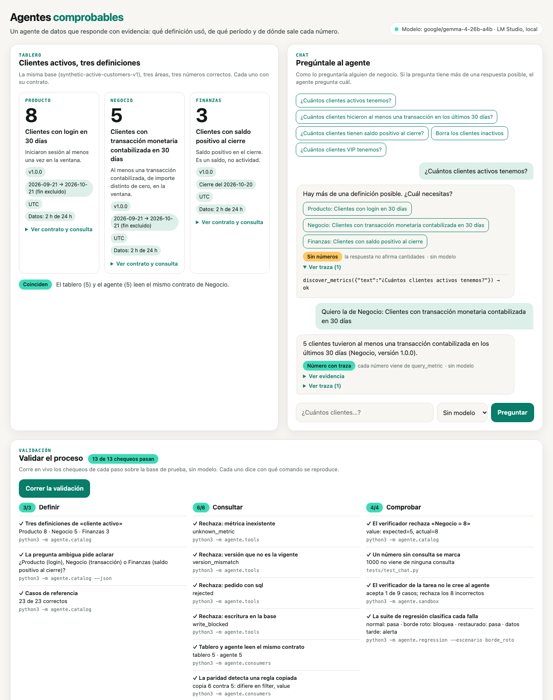

# Agentes comprobables

Un agente de datos que responde preguntas de negocio **con evidencia**: qué definición usó, de qué período y de qué
consulta sale cada número. Incluye un tablero, un chat y una validación del proceso que se corre desde el navegador.

Todo es Python 3 y SQLite de la biblioteca estándar. No hay dependencias que instalar. El chat usa un **modelo local
con LM Studio**: tus datos no salen de tu computadora.



## Probarlo en un minuto

```bash
git clone https://github.com/MartinCalderon-x/agentes-comprobables.git
cd agentes-comprobables
python3 app.py
```

Se abre `http://127.0.0.1:8000` con tres paneles:

- **Tablero.** Tres definiciones de «cliente activo» sobre la misma base: Producto 8, Negocio 5 y Finanzas 3. Cada
  tarjeta muestra su contrato (dueño, versión, período, antigüedad de los datos) y la consulta SQL que la produce.
- **Chat.** Pregunta como lo haría alguien de negocio. Si la pregunta admite más de una definición, el agente pregunta
  cuál. Cada respuesta trae su evidencia y su traza de llamadas, y marca si algún número no salió de una consulta.
- **Validación.** Corre en vivo los chequeos del proceso y dice con qué comando se reproduce cada uno.

Requisitos: Python 3.10 o posterior. Probado en macOS y Linux.

## El modelo: LM Studio, local

1. Instala [LM Studio](https://lmstudio.ai) y descarga un modelo con soporte de herramientas. Probado con
   `google/gemma-4-26b-a4b`; `google/gemma-4-e4b` es una opción más liviana.
2. En LM Studio, enciende el servidor local (pestaña *Developer*, puerto `1234`).
3. Corre `python3 app.py`. Arriba a la derecha se ve qué modelo responde.

Si LM Studio no está encendido, el chat **sigue funcionando sin modelo**: aplica el mismo proceso con reglas fijas
(busca en el catálogo por palabras, pregunta si hay ambigüedad, consulta y verifica). En la pantalla se puede forzar
cualquiera de los dos modos.

| Variable | Para qué | Por defecto |
|---|---|---|
| `AGENTE_BASE_URL` | Servidor compatible con la API de OpenAI | `http://localhost:1234/v1` (LM Studio) |
| `AGENTE_MODEL` | Modelo a usar | El cargado en LM Studio, o el primero de la lista probada |
| `AGENTE_API_KEY` | Solo para un servidor remoto | vacío |

## El proceso

Cada respuesta pasa por tres pasos, con o sin modelo:

| Paso | Qué hace | Dónde está |
|---|---|---|
| **Definir** | Cada métrica es un contrato: definición, dueño, versión, ventana de tiempo, filtros, frescura y origen. Una pregunta ambigua se aclara antes de consultar. | `data/metric_contracts.json`, `agente/catalog.py` |
| **Consultar** | Dos herramientas de solo lectura: `discover_metrics` busca en el catálogo y `query_metric` consulta por identificador y versión exactos. No hay SQL libre y la conexión no puede escribir. Tablero y chat leen el mismo contrato. | `agente/tools.py`, `agente/consumers.py` |
| **Comprobar** | Casos de referencia con el valor esperado, un verificador que rechaza respuestas incorrectas, un chequeo de que cada número tenga una consulta detrás, un verificador de tareas que mira el estado de la base y no el mensaje del agente, y una suite de regresión que bloquea o alerta. | `data/golden_questions.json`, `agente/chat.py`, `agente/sandbox.py`, `agente/regression.py` |

El detalle está en [docs/arquitectura.md](docs/arquitectura.md).

## Validar desde la terminal

```bash
python3 -m unittest -v                       # 56 pruebas, sin modelo ni red
python3 -m agente.validacion                 # los 13 chequeos del proceso, agrupados por paso
python3 -m agente.catalog                    # las tres métricas y los casos de referencia
python3 -m agente.catalog --mutate-lower-bound   # rompe un borde de fecha a propósito: sale con 1
python3 -m agente.regression --escenario borde_roto   # la suite bloquea; con datos_tarde, alerta
```

## Evaluaciones con un modelo

Las corridas con modelo no forman parte de las pruebas porque dependen del modelo y tardan. Se corren aparte y sus
resultados quedan en `evals/results/`, también las que salieron mal.

```bash
python3 evals/tools_eval.py      # las dos herramientas con cinco preguntas
python3 evals/context_eval.py    # todo el contexto en el prompt contra búsqueda selectiva
```

Resultados guardados (temperatura 0; las tres repeticiones de cada pregunta dieron siempre lo mismo):

| Evaluación | Modelo | Resultado |
|---|---|---|
| Herramientas | `google/gemma-4-26b-a4b` (LM Studio) | 5 de 5 preguntas |
| Herramientas | `google/gemini-2.5-flash` (OpenRouter) | 5 de 5 con la búsqueda actual; la primera versión, que buscaba por palabras sueltas, fallaba la pregunta sobre transacciones (`herramientas_v1_busqueda_por_palabras.json`) |
| Contexto, todo en el prompt | `google/gemma-4-26b-a4b` (LM Studio) | 8 de 8 preguntas, 0 números inventados, 27 s por respuesta en promedio |
| Contexto, búsqueda selectiva | `google/gemma-4-26b-a4b` (LM Studio) | 8 de 8 preguntas, 0 números inventados, 9 s por respuesta en promedio |
| Contexto, todo en el prompt | `google/gemini-2.5-flash` (OpenRouter) | 5 de 8: pidió aclarar preguntas que no eran ambiguas |
| Contexto, búsqueda selectiva | `google/gemini-2.5-flash` (OpenRouter) | 6 de 8, y en una respondió «1000» sin consultar (el dato era 3) |

La calificación es por reglas explícitas (`grade` en cada script), no por otro modelo. La búsqueda actual se ajustó
con la misma pregunta que fallaba, así que esa pregunta no sirve como prueba de que generaliza.

## Estructura

```
app.py                  servidor y API (biblioteca estándar, solo 127.0.0.1)
web/index.html          tablero, chat y validación (sin librerías externas)
agente/
  catalog.py            contratos, consultas permitidas, respuestas con procedencia, verificador
  tools.py              discover_metrics y query_metric, solo lectura
  consumers.py          tablero y agente sobre el mismo contrato; prueba de paridad
  chat.py               agente de chat, con modelo o sin modelo, y chequeo de evidencia
  llm.py                cliente de modelos (LM Studio por defecto)
  sandbox.py            entorno, tarea y verificador de estado
  regression.py         suite que pasa, bloquea o alerta
  validacion.py         los chequeos del proceso, para la pantalla y la terminal
data/                   base SQLite de prueba (se crea en memoria), contratos y casos de referencia
evals/                  evaluaciones con modelo y sus resultados
tests/                  pruebas
docs/                   arquitectura, catálogo y decisiones (docs/adr)
```

## Límites

Es una base de prueba de 12 clientes con tres métricas, pensada para mostrar y reproducir el proceso, no un
benchmark. El chat sin modelo no interpreta lenguaje natural: busca palabras del catálogo. Los «agentes» del
verificador de tareas son guiones que reproducen errores típicos, no corridas de un modelo. La suite de regresión
cuida datos y reglas; si cambia el modelo, hay que repetir las evaluaciones. El patrón entorno, tarea y verificador
está inspirado en [WildAWM](https://arxiv.org/abs/2610.26828); este código no replica su entrenamiento ni sus
resultados.

## Licencia

MIT. Ver [LICENSE](LICENSE).
